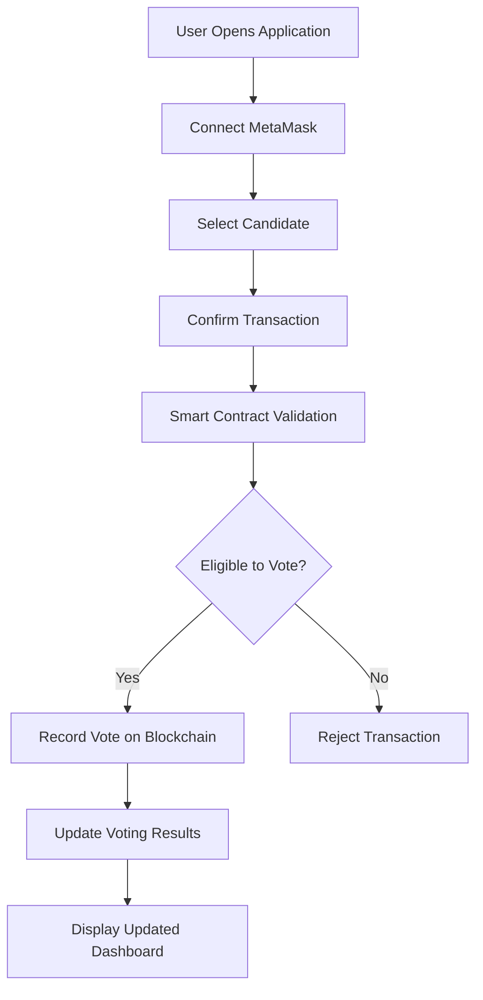

# Blockchain-Based Voting System

A decentralized voting application built with **Solidity, Hardhat, React, Vite, Ethers.js, and MetaMask**. This project demonstrates how blockchain technology can be used to create a transparent voting system with smart contract-based vote validation and wallet integration.

> **Project Status:** Local Development (Hardhat Local Network)

## Overview

The Blockchain-Based Voting System is a decentralized application (DApp) that allows users to participate in an electronic voting process through their MetaMask wallets.

Voting operations are handled by a Solidity smart contract deployed on a local Hardhat blockchain network. Each wallet address is restricted to one vote, while voting records are stored transparently on the blockchain.

The application provides two interfaces: User Mode for voters and Admin Mode for contract owners.

## Features

### User Mode
- Connect a wallet using MetaMask.
- View available candidates and their vote counts.
- View vote percentages and total voting statistics.
- Cast a vote through a MetaMask transaction.
- Check whether the connected wallet has already voted.
- View voting status and remaining duration.
- Monitor voter activity and blockchain-based voting records.

### Admin Mode
- Restricted to the smart contract owner.
- Add candidates before the first vote is submitted.
- Monitor total voters and candidate statistics.
- View daily voter activity through analytics charts.
- Monitor recently registered voters.
- Manage voting information through blockchain data.

## Voting Rules

| Rule | Description |
|---|---|
| One Wallet, One Vote | Each wallet address can vote only once. |
| Candidate Management | Only the contract owner can add candidates. |
| Candidate Lock | Candidates cannot be added after the first vote. |
| Voting Duration | Voting remains open for seven days after contract deployment. |
| Transparency | Voting transactions and voter addresses are publicly recorded on-chain. |
| Vote Validation | Smart contract validates voting eligibility and candidate selection. |

## Technology Stack

| Technology | Purpose |
|---|---|
| React 19 | Frontend user interface |
| Vite | Frontend development and build tool |
| JavaScript | Application logic |
| Solidity 0.8.20 | Smart contract development |
| Hardhat 2 | Local blockchain development environment |
| Ethers.js 5 | Blockchain interaction |
| MetaMask | Wallet connection and transaction authorization |
| CSS | User interface styling |
| Node.js & npm | Development environment |

## System Architecture

The application consists of four main components:

1. **Frontend (React + Vite):** Displays the voting interface, candidate information, and voting statistics.
2. **MetaMask:** Connects user wallets and requests transaction authorization.
3. **Hardhat Local Network:** Provides a local Ethereum-compatible blockchain for development and testing.
4. **Smart Contract (Solidity):** Handles candidate management, vote validation, voting duration, and vote recording.

### Voting Workflow



## Project Structure

```text
voting-blockchain/
│
├── contracts/
│   └── Voting.sol
│
├── scripts/
│   └── deploy.js
│
├── test/
│
├── voting-frontend/
│   ├── src/
│   │   ├── abi/
│   │   └── config.js
│   ├── package.json
│   └── ...
│
├── hardhat.config.js
├── package.json
├── package-lock.json
└── README.md
```

## Installation & Setup

Follow these instructions to run the application locally.

### Prerequisites

Make sure you have installed:

- Node.js
- npm
- MetaMask browser extension
- Git

### 1. Clone the Repository

```bash
git clone https://github.com/fauzanarroyyan19/voting-blockchain.git

cd voting-blockchain
```

### 2. Install Smart Contract Dependencies

```bash
npm install
```

### 3. Start the Local Blockchain

Open a terminal and run:

```bash
npx hardhat node
```

Keep the terminal running.

The local blockchain uses the following configuration:

| Setting | Value |
|---|---|
| Network | Hardhat Local |
| RPC URL | http://127.0.0.1:8545 |
| Chain ID | 31337 |
| Currency | ETH |

### 4. Compile and Deploy the Smart Contract

Open another terminal in the project root directory.

Compile the contract:

```bash
npx hardhat compile
```

Deploy it to the local network:

```bash
npx hardhat run scripts/deploy.js --network localhost
```

The deployment script automatically:

- Deploys the Voting smart contract.
- Initializes the default candidates.
- Sets the voting duration to seven days.
- Updates the contract address in the frontend configuration.
- Copies the compiled contract ABI into the frontend directory.

### 5. Configure MetaMask

Add a custom network to MetaMask using these settings:

| Setting | Value |
|---|---|
| Network Name | Hardhat Local |
| RPC URL | http://127.0.0.1:8545 |
| Chain ID | 31337 |
| Currency Symbol | ETH |

Import one of the development accounts provided by Hardhat for local testing.

**Important:** Hardhat development accounts and their private keys are public test credentials. Never use them on public networks or with real funds.

### 6. Install Frontend Dependencies

Open another terminal:

```bash
cd voting-frontend
npm install
```

### 7. Run the Frontend

```bash
npm run dev
```

Open the local development URL displayed in your terminal, usually:

```text
http://localhost:5173
```

The application is now ready for local testing.

## Important Notes & Limitations

- This project currently runs on a local Hardhat blockchain network.
- It is not deployed to Sepolia or any public blockchain network.
- The frontend requires the local Hardhat node and deployed contract to be running.
- Restarting the Hardhat node resets its blockchain state and removes previous voting records.
- The smart contract must be deployed again after restarting the local node.
- MetaMask must be connected to the correct local network.

## Future Improvements

Potential improvements for future development include:

- Deploying the smart contract to an Ethereum testnet.
- Hosting the frontend for public access.
- Integrating decentralized storage for additional voting-related information.
- Improving smart contract security and testing coverage.
- Adding more advanced voting analytics.
- Enhancing accessibility and responsive user experience.

## Learning Outcomes

Through this project, I explored and implemented:

- Smart contract development using Solidity.
- Local blockchain development with Hardhat.
- Web3 integration using Ethers.js.
- MetaMask wallet connectivity.
- Blockchain transaction handling.
- Smart contract access control and voting validation.
- Building a decentralized application using React.

## Author

**Fauzan Ar Royyan**

Informatics Graduate | Web Developer | AI & Machine Learning Enthusiast

- GitHub: [@fauzanarroyyan19](https://github.com/fauzanarroyyan19)
- Project Repository: [Blockchain-Based Voting System](https://github.com/fauzanarroyyan19/voting-blockchain)

---

*Developed as a learning and portfolio project to explore blockchain technology and decentralized application development.*
