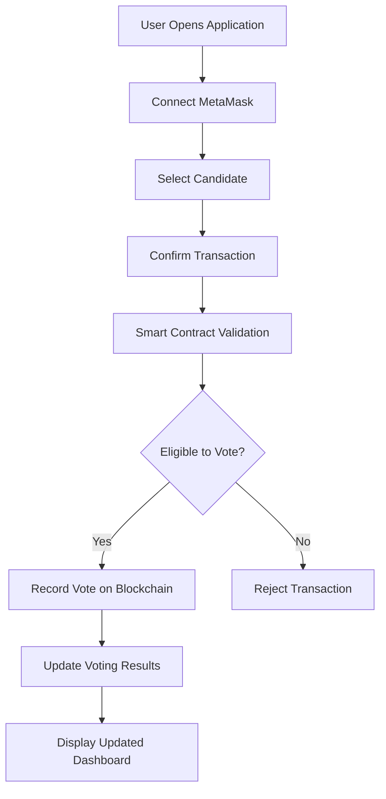
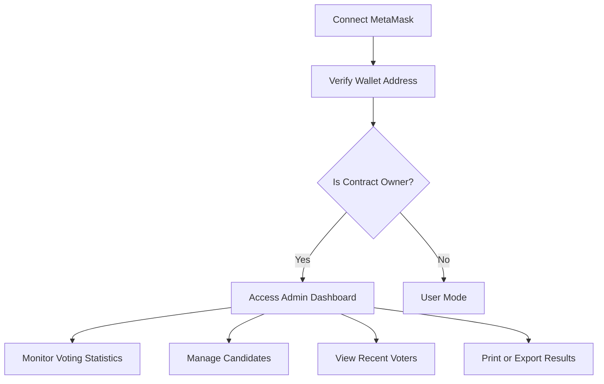

# 🗳️ Blockchain-Based Voting System

A decentralized voting application built with **React, Vite, Solidity, Hardhat, Ethers.js, and MetaMask**. This project demonstrates the implementation of blockchain technology in a transparent voting system, where voting processes and results are managed through smart contracts.

> **Project Status:** Local Development  
> **Blockchain Network:** Hardhat Local  
> **Deployment:** Not deployed to a public blockchain.

---

## 📌 Project Overview

The Blockchain-Based Voting System is a decentralized application (DApp) designed to provide a transparent and reliable electronic voting process using blockchain technology.

The frontend is developed using React and Vite, while Solidity smart contracts handle voting logic, candidate management, and vote validation. Ethers.js connects the frontend to the smart contract, and MetaMask allows users to connect their wallets and authorize voting transactions.

The application provides two main modes:

- **User Mode:** Allows voters to view candidates, cast votes, and monitor election results.
- **Admin Mode:** Allows the contract owner to manage candidates and monitor voting activities.

All voting transactions are recorded on the local blockchain network.

## ✨ Key Features

### 👤 User Mode

- **MetaMask Integration:** Connect a wallet to access the voting application.
- **Candidate List:** View available candidates and their information.
- **Voting System:** Cast a vote through a MetaMask transaction.
- **Vote Statistics:** View total votes and percentage distribution for each candidate.
- **Voter Information:** Monitor total voter participation and other voter statistics.
- **Voting Status:** Check whether the connected wallet has already voted.
- **Election Countdown:** View voting status and remaining time until the election ends.
- **Blockchain Transparency:** Successfully submitted votes are recorded on the blockchain.

### 🔐 Admin Mode

Admin Mode is exclusively accessible to the wallet address that owns the deployed smart contract.

- **Candidate Management:** Add new candidates before the first vote is submitted.
- **Voting Statistics:** Monitor total voters, candidates, and election status.
- **Voter Analytics:** View daily voter participation through statistical charts.
- **Recent Voters:** Monitor the latest voting activity.
- **Export Results:** Print or save election results as a PDF using the **Print Results** feature.

## 📜 Voting Rules & Mechanism

The voting process is governed by predefined smart contract rules to maintain consistency and transparency.

| Rule | Description |
|---|---|
| One Wallet, One Vote | Each wallet address can only vote once. |
| Admin Authorization | Only the contract owner can manage candidates. |
| Candidate Lock | Candidate registration is locked after the first vote. |
| Voting Duration | The election lasts seven days from smart contract deployment. |
| Public Records | Wallet addresses and voting transactions are publicly recorded on the blockchain. |
| Vote Validation | Voting eligibility and candidate selection are validated by the smart contract. |

## 🛠️ Technology Stack

| Technology | Purpose |
|---|---|
| React | Frontend development |
| Vite | Frontend build tool and development server |
| JavaScript | Application logic |
| Solidity | Smart contract development |
| Hardhat | Local blockchain development and contract deployment |
| Ethers.js | Interaction between frontend and smart contracts |
| MetaMask | Wallet connection and transaction authorization |
| CSS | User interface styling |
| Node.js & npm | Development environment and package management |

## 🏗️ System Architecture

The application consists of four main components:

1. **Frontend:** React and Vite provide the user interface for voting, administration, and result monitoring.
2. **Wallet Integration:** MetaMask connects user wallets and authorizes blockchain transactions.
3. **Blockchain Network:** Hardhat Local provides an Ethereum-compatible environment for smart contract execution.
4. **Smart Contract:** Solidity handles voting rules, candidate management, vote validation, and on-chain records.

### Voting Workflow



### Admin Workflow



## 📂 Project Structure

```text
voting-blockchain/
│
├── contracts/
│   └── Voting.sol
│
├── scripts/
│   └── deploy.js
│
├── test/
│   └── Lock.js
│
├── voting-frontend/
│   ├── public/
│   │   └── vite.svg
│   │
│   ├── src/
│   │   ├── abi/
│   │   │   └── Voting.json
│   │   ├── assets/
│   │   │   └── react.svg
│   │   ├── App.css
│   │   ├── App.jsx
│   │   ├── config.js
│   │   ├── index.css
│   │   └── main.jsx
│   │
│   ├── .gitignore
│   ├── eslint.config.js
│   ├── index.html
│   ├── package.json
│   ├── package-lock.json
│   ├── README.md
│   └── vite.config.js
│
├── .gitignore
├── hardhat.config.js
├── package.json
├── package-lock.json
└── README.md
```

## 🚀 Installation & Setup

Follow these steps to run the application locally.

### Prerequisites

Make sure you have installed:

- Node.js and npm
- Git
- MetaMask browser extension

### 1. Clone the Repository

```bash
git clone https://github.com/fauzanarroyyan19/voting-blockchain.git

cd voting-blockchain
```

### 2. Install Smart Contract Dependencies

```bash
npm install
```

### 3. Start Hardhat Local Network

Open a terminal in the project root directory:

```bash
npx hardhat node
```

Keep this terminal running while using the application.

### 4. Compile the Smart Contract

Open another terminal in the project root:

```bash
npx hardhat compile
```

### 5. Deploy the Smart Contract

Run the deployment script:

```bash
npx hardhat run scripts/deploy.js --network localhost
```

The deployment initializes the voting smart contract on the local Hardhat network.

### 6. Configure MetaMask

Add a custom network to MetaMask with the following configuration:

| Configuration | Value |
|---|---|
| Network Name | Hardhat Local |
| RPC URL | `http://127.0.0.1:8545` |
| Chain ID | `31337` |
| Currency Symbol | ETH |

Import one of the development accounts provided by Hardhat for local testing.

**Important:** Only use Hardhat development accounts for local testing. Never use their private keys or seed phrases for real wallets or public networks.

### 7. Install Frontend Dependencies

Open another terminal:

```bash
cd voting-frontend
npm install
```

### 8. Run the Frontend

```bash
npm run dev
```

Open the development URL displayed in your terminal, usually:

```text
http://localhost:5173
```

The application is now ready to use.

## 🌐 Network Configuration

This project currently uses the Hardhat Local Network.

| Configuration | Value |
|---|---|
| Network | Hardhat Local |
| RPC Endpoint | `http://127.0.0.1:8545` |
| Chain ID | `31337` |
| Currency | ETH |
| Environment | Local Development |

The application is intended for local development, testing, and demonstration purposes.

It is not currently deployed to Sepolia or any public blockchain network.

## ⚠️ Limitations & Important Notes

- The application requires a running Hardhat Local node.
- The smart contract must be deployed before the frontend can interact with it.
- Restarting or resetting Hardhat Local removes the existing local blockchain state and voting records.
- The smart contract must be deployed again after a network reset.
- MetaMask may need to refresh its account transaction data after a local network reset.
- Voting records and wallet addresses are visible on the blockchain.
- Public access requires deployment to a suitable public blockchain network and frontend hosting.

## 🔮 Future Improvements

Potential improvements for future development include:

- Deploying smart contracts to Sepolia Testnet.
- Hosting the frontend for public access.
- Implementing more comprehensive smart contract security testing.
- Improving voter analytics and reporting.
- Enhancing the user interface and accessibility.
- Adding additional voting management capabilities.

## 📚 Learning Outcomes

This project provided practical experience in:

- Decentralized Application (DApp) development.
- Smart contract programming using Solidity.
- Local blockchain development with Hardhat.
- Web3 integration using Ethers.js.
- MetaMask wallet integration.
- Blockchain transaction handling.
- Smart contract access control.
- Building interactive dashboards using React.

## 👨‍💻 Author

**Fauzan Arroyyan**

Informatics Graduate | Web Developer | AI & Machine Learning Enthusiast

- GitHub: [@fauzanarroyyan19](https://github.com/fauzanarroyyan19)
- Repository: [Blockchain-Based Voting System](https://github.com/fauzanarroyyan19/voting-blockchain)

---

*Developed as a portfolio project to explore blockchain technology, smart contracts, and decentralized application development.*
